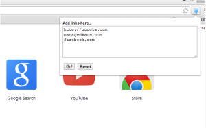

Open Links In Tabs
==================
## Open Links in Tabs: A Chrome Extension



The Chrome web browser is our go-to choice when surfing the web or developing sites for our customers.

We’ve developed an extension for Chrome called “Open Links in Tabs”.  Hopefully the cryptic name doesn’t disguise what this extension does!

## Installing
Follow this link to the [Chrome Web Store](https://chrome.google.com/webstore/detail/open-links-in-tabs/jlgojbammkhdbbohlihccohgbaccgpbm) and click the "Add to Chrome" button.


## Development and tests

Install a Node.js version supported by jsdom (Node.js 24 LTS is suitable), then run:

```sh
npm ci
make test
```

The tests use Node's built-in test runner and JSDOM to load the real popup
HTML, bundled jQuery, and popup script. Chrome's tab API is mocked, so no
browser windows open. Coverage includes URL protocols, whitespace and blank
lines, invalid entries, ordering and duplicates, repeated Go clicks, and Reset.
You can also run the suite with `npm test`.

Run `make` or `make help` to list all targets. The existing packaging targets
archive committed source from `HEAD`; `make pack` requires Google Chrome at
its macOS application path and `PEM_FILE` pointing to the extension signing key.
